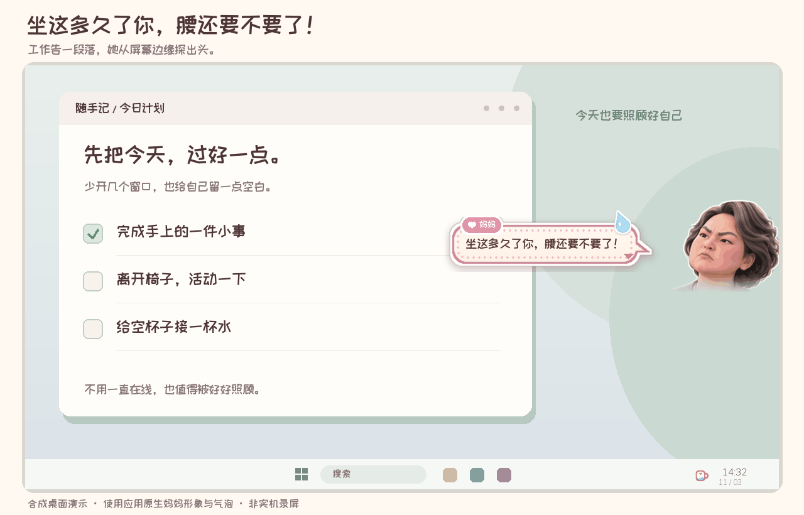

# 大水理论最严厉的母亲

*The Strictest Mom of the Big Water Theory*

**A desktop mom who reminds you to drink water, stand up, and eat when you work late.**

Windows desktop companion · Customize Mom’s appearance & lines · Runs locally

[**Download for Windows x64**](https://github.com/MichaelZSH9898/Big-water-inspector/releases/download/v0.1.0-preview/Big-water-inspector-0.1.0-preview-Windows-x64.zip) · [Setup guide](docs/DOWNLOAD.md#english) · [简体中文](README.md)

Windows only · Unsigned pre-release · Extract and run; no Python installation needed

Illustrated desktop, not a screen recording. Mom’s appearance, speech bubbles and placement use the app's own code. Gaps between scenes are shortened. Default flashes last about 2 seconds; the custom-line preview is held for 3 seconds.

## A little nagging. A little care.

She peeks in from the edge of your screen when you have been sitting too long. When you return, she may remind you about that glass of water. After a long working day, she checks whether you have eaten.

The app lives in the system tray. You can pause it or quit at any time.

## Say hello

On Windows x64, extract the entire portable ZIP and open **`1-先看演示.cmd`** to start the app and preview three scenes. Python is included; you do not need to install it.

Open **`2-打开设置.cmd`** for settings, or **`3-退出程序.cmd`** to quit. You can also use the pink cup in the system tray. The filenames are numbered so you can identify them without reading Chinese.

[Download the Windows x64 preview (release page)](https://github.com/MichaelZSH9898/Big-water-inspector/releases/tag/v0.1.0-preview) · [Download instructions and source setup](docs/DOWNLOAD.md#english). This is an unsigned preview build. Desktop reminders run on Windows only.

## Make the lines your own

Make Mom feel familiar: choose her appearance, hair color and the reminders she says.

In Settings, choose English, click a speech bubble, enter your line, then choose **Save & demo**. Custom lines survive changes to Mom’s appearance or language. You can switch back to the defaults without losing your edits.

Customize Mom using appearance presets, eight hair-color presets and a custom color picker. [Mom appearance previews](docs/characters_en.png).

## Timing matters

- Soft sitting reminders wait for a pause or task change. A hard sitting limit can still trigger during continuous work.
- Detected meetings, fullscreen use and Do Not Disturb block reminders. Detection depends on Windows and application behavior.
- Normal reminders are at least 20 minutes apart by default.
- The late-work scene requires at least 8 effective hours and a local time after 17:30; it appears at most once per day.
- Thresholds, quiet hours and display duration are configurable.

## Local by design

No account, screenshots, audio/video recording or keystroke logging. The app uses system metadata. Browser titles are briefly used in memory for classification and are not logged. The app has no network feature; source dependency installation uses the network.

Existing Python-source-build measurements and current verification limits are documented in [Validation](docs/VALIDATION.md). They are not performance guarantees for this portable build.

## Add a familiar voice

Suggest a reminder, report a problem, or [customize Mom’s appearance pack](persona/README.md). Artwork and line packs can be changed without editing the reminder engine.

[Contributing](CONTRIBUTING.md) · [Detailed guide (Chinese)](docs/USER_GUIDE.md)

Code and documentation: [MIT](LICENSE). Character artwork and fonts: [separate notices](ASSET_NOTICES.md).
