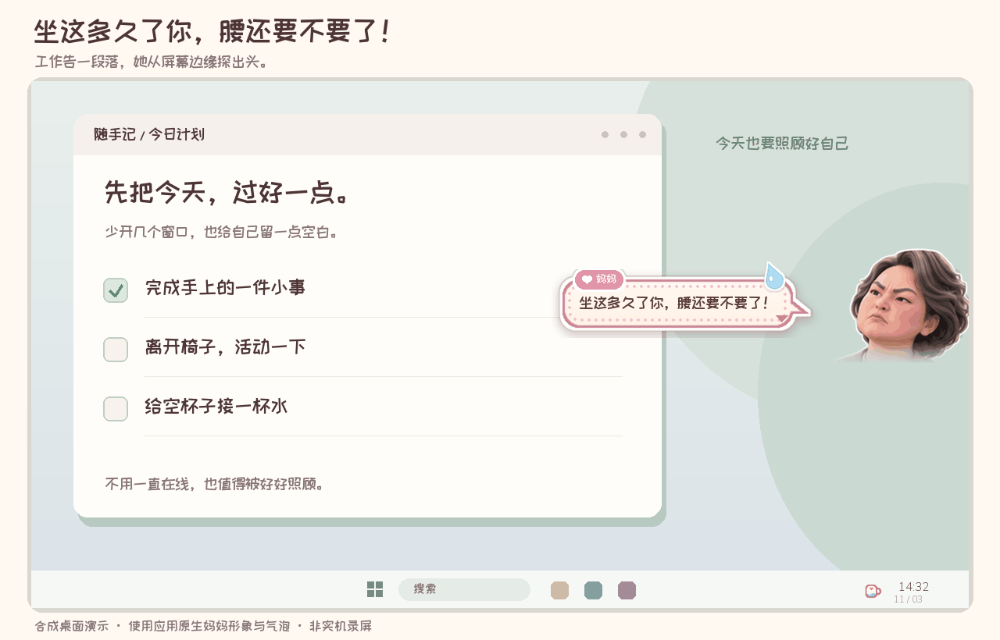
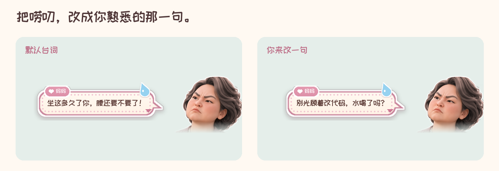
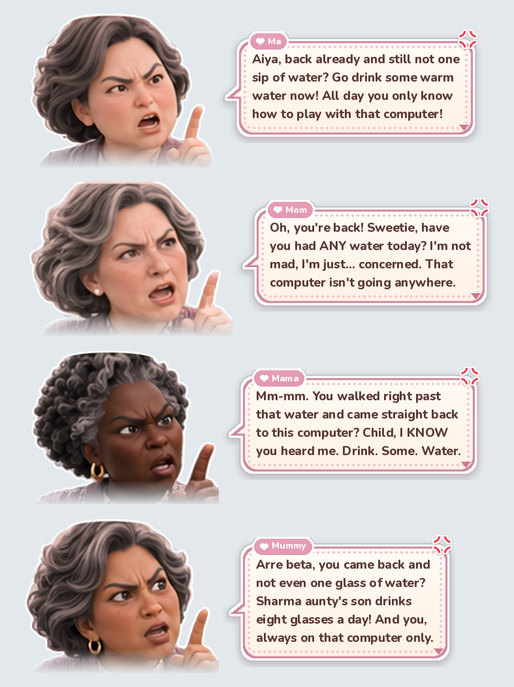

# 大水理论最严厉的母亲

**把妈妈请进电脑，催你喝水、起身，也惦记你有没有吃饭。**

Windows 桌面提醒 · 妈妈形象可自定义 · 可改台词 · 本地运行

[**下载 Windows x64 试用版**](https://github.com/MichaelZSH9898/Big-water-inspector/releases/download/v0.1.0-preview/Big-water-inspector-0.1.0-preview-Windows-x64.zip) · [使用说明](docs/DOWNLOAD.md) · [改一句自己的台词](#换成你最熟悉的那一句) · [English](README.en.md)

仅支持 Windows · 未签名的 Pre-release 试用版 · 解压后运行，无需安装 Python

合成桌面演示，未使用真实桌面截图。妈妈形象、气泡和位置由应用自身代码生成；场景间隔压缩，默认闪现约 2 秒，自定义台词预览延长至 3 秒。

## 嘴上唠叨，心里惦记

**坐久了，她从屏幕边上探头：**“坐这多久了你，腰还要不要了！”

**解锁回来，她还记得那杯水：**“多大人了，水都不知道喝？”

**忙到晚上，她又放轻了语气：**“今天又加班吗？……辛苦一天别饿着自己。”

她平时待在托盘里，到合适的时机才出现。提醒完就离开，你也可以随时暂停或退出。

## 先让她来打个招呼

**Windows x64 试用包**：解压整个文件夹 → 双击 **`1-先看演示.cmd`** → 看三个场景。
无需安装 Python。演示后进入正常提醒，托盘里的粉色小水杯表示正在运行。

然后双击 **`2-打开设置.cmd`**，调整妈妈的形象，点气泡改台词。退出可用托盘菜单，或 **`3-退出程序.cmd`**。

→ **[下载 Windows x64 试用包（发布页）](https://github.com/MichaelZSH9898/Big-water-inspector/releases/tag/v0.1.0-preview)** · [下载方式、源码运行与常见问题](docs/DOWNLOAD.md)

仅支持 Windows 桌面；当前是未签名的试用版。其他系统可以阅读代码、运行核心测试，不能运行桌面提醒。

## 换成你最熟悉的那一句

打开设置 → 点预览里的气泡 → 输入台词 → 回车 → **保存并演示**。

你改过的台词会保留，调整妈妈形象或语言也不会丢；“默认 / 自定义”可以随时切换。
**妈妈的形象和台词，由你来定。**
现有外观预设用于调整妈妈的形象；发色有八种预设，也可以自由取色。界面与台词可选中文或 English。

看看设置，调整妈妈的形象

妈妈形象素材由维护者使用 ChatGPT 辅助生成，来源与授权范围见 [素材说明](ASSET_NOTICES.md)。

## 会唠叨，也会看时机

| 什么时候 | 她怎么做 |
|---|---|
| 久坐达到提醒阈值，刚好停下来或切换任务 | 从右边探头，提醒起身或喝水 |
| 离开后解锁，饮水提醒也到点了 | 在屏幕上方出现 |
| 当天有效使用达到 8 小时，且已过 17:30 | 在右下角送来一句关心，每天一次 |
| 检测到会议、全屏或勿扰状态 | 暂缓或放弃提醒 |

默认任意两次正常提醒至少间隔 20 分钟。达到久坐硬上限时，可能在持续工作中提醒；这些规则基于系统信号，不能保证识别每一种应用状态。
阈值、静默时段、台词停留时长均可调整。详见 [使用说明](docs/USER_GUIDE.md#它什么时候出现)。

## 关于隐私和资源

- **不截屏，不录音录像，不记录键盘内容**。读取空闲时长、锁屏事件、应用类别及设备占用状态；浏览器标题仅在内存中用于分类，不写入日志。
- **无需登录，应用没有联网功能**。配置和运行日志保存在本地文件夹；安装源码依赖时需要联网下载。
- **提醒窗口按设计不抢输入焦点、鼠标可穿透**。设置界面在你主动打开时单独运行。
- 项目附带的 Windows 11 / Python 源码版一小时空闲实测：内存最高约 **30.5 MB**。这是既有单机记录；当前便携包的完整资源表现、多屏及不同缩放仍待进一步实测。

数据口径与已测、未测范围见 [验证说明](docs/VALIDATION.md)。

## 你家的那句唠叨，也可以留下来

欢迎提交一句你熟悉的妈妈式唠叨、分享使用反馈，或制作自己的妈妈形象包。
调整妈妈的图片和台词不需要修改核心代码。

[自定义妈妈形象](persona/README.md) · [参与贡献](CONTRIBUTING.md) · [完整使用说明](docs/USER_GUIDE.md)

如果你想继续看妈妈形象的新预设和后续改进，可以给项目一个 Star，方便以后再找到它。

---

代码与文档：[MIT](LICENSE) · 妈妈形象素材与字体：[单独授权说明](ASSET_NOTICES.md)
