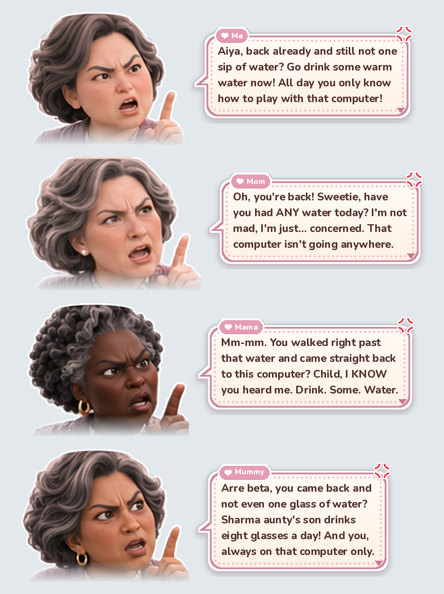

# 大水理论最严厉的母亲

一个几乎不占资源的 Windows 后台小程序。它不按钟点提醒，而是等你“高概率可以被打断”的时刻——刚解锁回来、
刚从代码切到浏览器、敲完一段停下来——让一位中国妈妈从屏幕上闪现 2 秒，用“打是亲骂是爱”的方式叫你喝水、起身。

- **尽量避开忙碌时刻**：会议（麦克风/摄像头在用）、全屏、演示、勿扰时绝不出现；心流中只有久坐到硬上限才出现。
- **不做重型监控**：只读系统元数据（空闲时长、前台程序类别、锁屏事件），事件驱动；不截屏、不采集窗口正文、
  不挂键鼠钩子，窗口标题只在内存里用于分类、用完即弃。


---

## 安装

1. 安装 **Python 3.11 或更新版本**（python.org 的安装包即可，勾选 “Add python.exe to PATH”，默认自带 tkinter）。
2. 在本文件夹打开命令行：

   ```bash
   pip install -r requirements.txt
   ```

   `pillow` 给设置界面和立绘渲染用；`psutil` 只有资源实测脚本用。**常驻的哨兵进程本身只用标准库**，不装也能跑
   （前提是已有渲染缓存；首次从干净源码运行请先安装依赖）。

## 运行

| 做什么 | 怎么做 |
|---|---|
| 启动 | 双击 `启动督察员.bat`（等同 `pythonw main.py`）。托盘里出现一个粉色小水杯就是在运行 |
| 开机自启 | 托盘右键 → 开机自启（写当前用户的 Run 注册表项，不需要管理员） |
| 快速自查 | 双击 `演示模式.bat`：所有时间阈值 ×1/60（分钟变秒），并在控制台打印日志 |
| 立刻看三个场景 | 托盘右键 → 演示一次 |
| 打开设置 | 托盘右键 → 设置，或双击 `打开设置.bat` |
| 更新程序文件后 | 双击 `重启督察员.bat`（让正在运行的督察员体面退出，再启动新版本） |
| 退出 | 托盘右键 → 退出 |

**托盘图标**：一个粉色小水杯，饮水账越高水越少（5 档，见底时冒红色感叹号）；鼠标悬停看饮水/久坐两本账。
**托盘菜单**：暂停 1 小时 / 暂停到明天 / 今日统计（有效时长、各场景出现·响应·屏蔽次数）/ 设置 / 演示一次 / 开机自启 /
打开日志文件夹 / 退出。

**设置界面**（托盘 → 设置）：养成系的“换装”界面——左边妈妈形象卡（立绘、性格标签、今日口渴值 / 久坐值 / 有效时长），
右边换发色（8 个预设 + 自由取色）、肤色、语言（中文 / English），下面实时预览各场景的闪现图和出现位置。

- **自定义妈妈形象**：外观预设用于调整妈妈的形象与肤色，发色可以单独选择。应用中的角色就是妈妈，不同预设不是不同身份。
- **台词**：中文用华裔妈妈的台词；英文按所选的妈妈各有一套（华裔妈妈的“Aiya, drink warm water”、白人妈妈的
  “I'm not mad, I'm just… concerned”、黑人妈妈的“Child, I KNOW you heard me”、印度裔妈妈的“Arre beta, Sharma aunty's son…”）。
- **在预览里直接改台词**：点气泡就能改，回车完成。改过的台词与肤色、语言无关，调整妈妈形象或语言照样保留；
  预览区右上角的“默认 / 自定义”随时切换，自定义的内容不会丢。侧边探头有“久坐版 / 喝水版”两句，分别可改。
点“保存”会写入 `config.toml`、按你的显示器重新渲染立绘、通知哨兵立即生效；“保存并演示”保存后立刻让三个场景各闪一次。




## 它什么时候出现

| 场景 | 条件 | 位置 |
|---|---|---|
| A 解锁训话 | 锁屏 ≥ 5 分钟后解锁，且饮水账 ≥ 60 有效分钟；3 秒后复查，正在开会/全屏就放弃；每 2 小时最多 1 次 | 屏幕中央偏上 |
| B 侧边探头 | 久坐账 ≥ 50 且处于断点或游离；或久坐账 ≥ 100（硬上限，心流也挡不住）。饮水超得更多时换饮水台词 | 右侧边缘探出半身 |
| C 加班关怀 | 今日有效时长 ≥ 8 小时且已过 17:30，每天一次；被挡住就在解除后补上 | 右下角 |

任意两次闪现至少间隔 20 分钟。全部参数在 `config.toml` 里，带中文注释。规则细节和我做的取舍见 `DECISIONS.md`。

**两本账**按“有效分钟”累加：有键鼠输入的分钟算；没输入但在看视频（有声音，且全屏或 20 分钟内碰过键鼠）也算；
短暂停顿先计入，连续 5 分钟无输入无声音就回溯剔除。锁屏 ≥ 5 分钟久坐账清零（饮水账不变——离开不代表喝了水）；
锁屏 1–5 分钟饮水 −50%、久坐 −30%（很可能是去接水了）。场景出现后 10 分钟内你锁屏或离开 2 分钟，就算“响应”，对应的账清零。

## 配置

编辑 `config.toml` 后保存即可（哨兵每分钟检查一次，或在设置界面点保存立即生效）。写坏了不会崩溃，会沿用默认值并在
`logs/app.log` 里说明。常改的几项：

- `[policy] quiet_hours = [["12:00", "13:30"]]`：静默时段
- `[policy] water_threshold_min / sitting_soft_min / sitting_hard_min`：三个阈值
- `[categories]`：应用分类表（进程名 → 生产力/沟通/浏览器/娱乐/会议），浏览器再按标题关键词细分
- `[general] demo_mode = true`：演示模式

## 角色包

想换成自己画的妈妈形象：见 **[persona/README.md](../persona/README.md)**。复制 `persona/default_mom/`，换图改字，
不用改任何代码。角色包坏了会自动回退到默认包，不会崩溃。

## 日志与对外接口

- `logs/events.jsonl`：当天的事件，一行一条；每天 04:00 归档为 `events-日期.jsonl`，保留 30 天，总量 ≤ 20 MB。
- `logs/daily.jsonl`：每日摘要（有效时长，各场景出现/响应/屏蔽次数）。
- `logs/app.log`：程序运行日志，出问题先看这里。
- `state.json`：每分钟写一次，供以后“每日一题”读取（督察员只写不读）。

事件字段（`v` = 1）：

| 字段 | 含义 |
|---|---|
| `ts` / `day` / `type` | 时间、所属日期（04:00 换日）、事件类型：`flash` 闪现 / `blocked` 被挡的候选 / `outcome` 结果 / `absence` 离开 / `app` 程序事件 |
| `id` / `scene` / `line` | 闪现编号、场景（A/B/C）、台词键 |
| `water` / `sitting` / `effective_today_min` | 当时的饮水账、久坐账、今日有效分钟 |
| `state` / `basis` / `facts` | 当时状态（meeting/fullscreen/dnd/flow/wander/break/normal）、触发依据、判定用到的数字（只有类别和计数） |
| `blocked` / `block_reason` | 是否被挡及原因（meeting / fullscreen / dnd / paused / quiet_hours / min_gap / cap / flow / waiting_break） |
| `result` | `pending`（等 10 分钟看是否响应）/ `responded` / `ignored` / `abandoned`（A 被挡后放弃） / `deferred` |

`state.json` 字段：`v`、`updated`、`day`、`state`、`water_min`、`sitting_min`、`effective_today_min`、`thresholds`、
`paused_until`、`scenes_today`、`demo_mode`、`diag`（唤醒次数，测资源用）。

## 测试与验证

```bash
python -m unittest discover -s tests            # 单元测试（第 6 节每条规则都有用例）
python -m sim.run sim/scripts/*.sim             # 模拟器：回放“典型的一天”和手工测试清单的每一条
python -m sim.run sim/scripts/*.sim --demo      # 同上，演示模式（×1/60）
```

在 Windows 上一键实测：双击 `tools\一键自检.bat`（装依赖 → 单元测试 → 模拟器 → 信号探针 → 闪现验收 → 多屏巡检 →
闪现回落测试），约 1 分钟，结果写在 `tools\reports\selfcheck.log`。其他双击即用的脚本：
`tools\探针_观察勿扰.bat`（边开关勿扰/全屏/会议边看信号）、`tools\测资源_办公1小时.bat`、`tools\测资源_空闲1小时.bat`、
`tools\看立绘_每个场景停8秒.bat`（在真实桌面上把三个场景各停 8 秒，看清立绘和气泡）、`tools\看设置界面_25秒后自动关.bat`。

| 脚本 | 验什么 |
|---|---|
| `tools/probe_signals.py --watch 90` | 各信号源此刻的值；期间开关勿扰、进出全屏、开会、放音乐，看哪些值跟着变 |
| `tools/accept_overlay.py` | 闪现期间用 SendInput 连续打字，逐字核对不丢字、焦点不变；闪现期间点它下方的按钮，必须点得到 |
| `tools/accept_overlay.py --tour` | 每块显示器上依次闪现 A/B/C，打印位置、尺寸、是否在屏内（目测 DPI/多屏） |
| `tools/measure.py --label idle --minutes 60` | 资源实测：RSS、平均 CPU、每分钟唤醒次数、日志占用，对照预算判定 |
| `tools/measure.py --flash` | 闪现结束后 1 秒内是否回落到空闲水平 |

## 资源与隐私

预算（只针对常驻哨兵）：内存 ≤ 40 MB；平均 CPU 空闲 ≤ 0.3%、办公 ≤ 0.5%；平时 30 秒醒一次（接近阈值时 5 秒），
只有淡出的 0.5 秒里 30 帧/秒；零网络访问；不申请管理员权限；仅在主动开启自启时写当前用户的自启项；不出现在任务栏和 Alt+Tab。

## 卸载

托盘 → 取消“开机自启” → 退出，然后删除本文件夹即可。

## 常见问题

- **一直不出现？** 看 `logs/events.jsonl` 里的 `blocked` 记录：是不是一直在开会（某个程序一直占着麦克风）、
  全屏，或者勿扰没关。托盘“今日统计”里也能看到屏蔽次数。
- **立绘位置/大小不对？** 删除 `persona/cache/` 后重启，或在设置里点一次保存。
- **想换回无声停顿立即算离开？** `config.toml` → `[effective] count_short_idle = false`。

## 目录结构

```
water-inspector/
├─ main.py              哨兵入口：托盘、消息循环、调度
├─ config.toml          全部可调参数
├─ signals/             信号层（每个信号一个文件，统一接口，fake.py 是假数据实现）
├─ core/                计时、两本账、状态识别、决策、日志（不碰 Windows，可在任何系统上测试）
├─ overlay/             闪现窗口（Win32 分层窗口）与挑图
├─ winapi/              ctypes 声明、隐藏窗口、托盘、显示器、开机自启、进程间通知
├─ persona/             角色包（独立、易改）与渲染器；cache/ 可随时删除
├─ settings_ui/         设置界面（独立进程；ui_render.py 用 Pillow 画界面，app.py 只管窗口和点击）
├─ sim/                 模拟器与脚本化的一天
├─ assets/tray/         托盘图标（5 档水位小水杯）
├─ docs/                README 里的预览图
├─ tools/               Windows 实测脚本；art_pipeline/ 是从角色设定图生成立绘、生成托盘图标的开发脚本
├─ tests/               单元测试
└─ README.md  PLAN.md  DECISIONS.md
```
